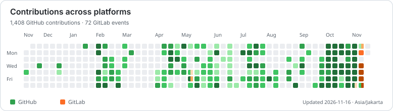

# Muhammad Ridwan Kusumahani

**Network & Security Automation · ISP Infrastructure · Software Engineering**

Building observable networks, practical defensive systems, and automation for the work behind production services.

[**Portfolio**](https://misuminitt.site) &nbsp;·&nbsp; [**GitLab**](https://gitlab.com/misuminitt) &nbsp;·&nbsp; [**LinkedIn**](https://www.linkedin.com/in/muhammad-ridwan-kusumahani-5210722a9/) &nbsp;·&nbsp; [**Technical notes**](https://misuminitt.site)

---

### About

I'm an **NOC & IT Infrastructure engineer at PT Panha Network Solution** and an **Informatics Engineering student at Universitas Ahmad Dahlan**. My work sits between network operations, security engineering, and software: keeping ISP services reachable, making infrastructure observable, and removing manual work through reliable tooling.

- **Network operations:** BGP/OSPF, subscriber access, PPPoE/RADIUS, MikroTik, Cisco, Huawei ATN, OLT/ONU, and backbone troubleshooting.
- **Observability & defense:** SNMP/RouterOS telemetry, Wazuh, OpenSearch, Grafana, DNS policy, WAF signals, and incident investigation.
- **Software & automation:** Python, Go, PHP, JavaScript/Node.js, Linux services, APIs, CI/CD, and internal business platforms.
- **Security research:** authorized testing, firmware analysis, reverse engineering, and coordinated disclosure. I keep non-public findings and customer details out of public repositories.

### Selected work

A mix of public projects, private operational systems, and ongoing research. Architecture and status are described at a high level where source code is not public.

| Area | Project | Scope |
| :-- | :-- | :-- |
| **Security · R&D** | **3GP — Three Guard Platform** | ML-assisted domain classification, safe asynchronous analysis, rule-based decisions, and DNS filtering research with Technitium DNS Server. Currently in validation; not presented as a production auto-blocker. |
| **Security operations** | **SOC & Security Monitoring Infrastructure** | Correlating Wazuh/OpenSearch logs, Grafana views, WAF telemetry, network segmentation, honeypots, and response workflows. |
| **Network engineering** | **[MikroTik API & SNMP Dashboard](https://github.com/misuminitt/mikrotik-api-snmp-dashboard)** | Traffic and health telemetry, DHCP/connection visibility, firewall/log inspection, heartbeat monitoring, and Telegram alerting. |
| **NOC automation** | **Monitor Web Server PNS / NMS** | Server availability checks, notifications, NAS operations, and recovery workflows built for daily operations. |
| **ISP operations** | **Billing & RADIUS Platform** | Subscriber and voucher lifecycle, RADIUS integration, scheduled service controls, payment workflows, and deployment engineering. *Private internal project.* |
| **Business systems** | **Finance & Employee Attendance** | Role-based finance, payroll, employee attendance, approvals, audit trails, and data integrations. *Private internal projects.* |
| **Provisioning** | **GenieACS Auto Provisioning** | WhatsApp/OCR-assisted onboarding and TR-069 provisioning with validation and retry handling. *Work in progress.* |

**More public builds:** [NetShield — ARP spoofing defense](https://github.com/misuminitt/netshield) · [True Speedtest — router RX/TX monitoring](https://github.com/misuminitt/true-speedtest) · [IndiHome FUP Monitor](https://github.com/misuminitt/indihome-fup-monitor) · [Guardian Discord Bot](https://github.com/misuminitt/guardian-bot-discord).

For broader project context, including infrastructure notes and my company's website work, see the [project archive on my portfolio](https://misuminitt.site).

### Tools I work with

| Layer | Technologies |
| :-- | :-- |
| **Network & access** | BGP · OSPF · VLAN · PPPoE · RADIUS · MikroTik RouterOS · Cisco IOS · Huawei ATN · SNMP · TR-069 / GenieACS |
| **Backend & automation** | Python · Go · PHP / CodeIgniter · Node.js / Express · JavaScript · Bash · REST APIs |
| **Infrastructure & data** | Linux · Nginx · Proxmox · Docker · MariaDB / MySQL · PostgreSQL · Git / CI/CD |
| **Monitoring & security** | Wazuh · OpenSearch · Grafana · Technitium DNS · Wireshark · Nmap · Burp Suite · OWASP ZAP |

**Learning & credentials:** MikroTik Certified Network Associate (MTCNA) · hands-on security research and CTF competition experience.

### Cross-platform activity

<picture>
  <source media="(prefers-color-scheme: dark)" srcset="./assets/contributions-dark.svg" />
  
</picture>

Green = GitHub contributions; orange = GitLab user activity events. The two services count different kinds of activity, so totals are shown separately rather than presented as a single commit count. Private project names and commit details are never included in these images.

### GitHub snapshot

  
  

### Notes & writing

- [Infrastructure security assessment — public, sanitized summary](https://www.misuminitt.site/blog/mataram-city-infrastructure-security-assessment)
- [GenieACS auto provisioning — development notes](https://www.misuminitt.site/blog/automisasi-genieacs)
- [Hack The Box labs journey](https://www.misuminitt.site/blog/hack-the-box-labs-journey)

  Operate what you build. Observe what you operate. Fix the cause.

